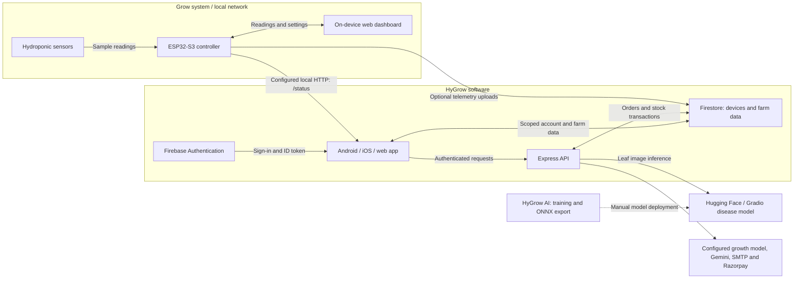

<p align="center">
  
</p>

# HyGrow

**See your grow system clearly. Keep your farm work connected.**

HyGrow brings together an ESP32-S3 sensor controller, an Android/iOS/web app,
and an API for hydroponics monitoring, farm management, and plant insights.
The board also hosts its own dashboard for local use.

[Mobile releases](https://github.com/Keys-3/HyGrow_Software/releases)
· [LiveContainer source](https://github.com/Keys-3/HyGrow_Software/releases/latest/download/apps.json)
· [Quick start](#quick-start)
· [Architecture](#system-architecture)

[](https://github.com/Keys-3/HyGrow_Software/actions/workflows/verify.yml)
[](https://github.com/Vaibhavsh0120/HyGrow_IoT/actions/workflows/verify.yml)

## What HyGrow does

| Area | Capability |
| --- | --- |
| **Grow-system monitoring** | Air temperature, humidity, water temperature, water level, light, TDS, and pH when the relevant sensors are enabled and calibrated. |
| **Local access** | An on-device dashboard and an optional configured `/status` connection from the app. |
| **Useful observations** | Sample freshness, sensor health, simulation labels, and charts from samples observed during the session. |
| **Farm management** | Inventory, marketplace listings, orders, and account-based access. |
| **Plant insights** | Leaf disease classification, growth inference, and AI chat through configured backend providers. |

> Physical pump control and irrigation automation are not implemented. AI,
> email, payments, and remote access need their respective services configured.

## System architecture



Sensors feed the board; readings reach the local dashboard, configured app HTTP,
or Firestore. The app prefers fresh configured local samples and falls back to
authenticated cloud readings. Missing values stay missing and simulation is labelled.

The firmware supports UDP discovery on **39400**; the app currently uses an
explicit local URL. Charts are session observations, not a persisted historical
archive. See the [telemetry guide](https://github.com/Keys-3/HyGrow_Software/blob/main/FrontEnd/docs/TELEMETRY.md).

## Get the mobile app

| Platform | Download / installation |
| --- | --- |
| **Android** | Get the `.apk` from the [latest release](https://github.com/Keys-3/HyGrow_Software/releases/latest). Supports ARM64 and ARMv7 phones. |
| **iOS** | Get the unsigned `.ipa` from the same release for LiveContainer or external signing. |
| **LiveContainer** | Open **Sources → +** and add the [HyGrow source](https://github.com/Keys-3/HyGrow_Software/releases/latest/download/apps.json). |

Copy this URL into LiveContainer:

```text
https://github.com/Keys-3/HyGrow_Software/releases/latest/download/apps.json
```

Every manual release reserves a new version and higher Android/iOS build numbers,
builds both packages, and updates the same source URL after successful publication.
The source becomes available with the first completed release. LiveContainer
installation and launch still need an iPhone check.

## Quick start

### 1. Clone all components

```sh
git clone --recurse-submodules https://github.com/Vaibhavsh0120/HyGrow.git
cd HyGrow
```

Already cloned? Initialize missing components with `git submodule update --init --recursive`.

### 2. Configure and start the software

Requires **Node.js 22.13 or newer**. Follow the
[first-time software setup](https://github.com/Keys-3/HyGrow_Software#first-time-setup)
to configure the environment files, then run:

```sh
cd HyGrow_Software
npm run install-all
npm start
```

Open the web address printed by Expo. The API runs on **port 3000**.
Stop both with **Ctrl+C**; use `npm start` for later runs.

### 3. Connect a device

Follow the [IoT wiring and flashing guide](https://github.com/Vaibhavsh0120/HyGrow_IoT).
Match `EXPO_PUBLIC_DEVICE_ID` to the board's configured device ID and provision
access to its `devices/{deviceId}` document. Optionally configure
`EXPO_PUBLIC_LOCAL_STATUS_URL` as `http://<device-ip>/status`.
Try the board dashboard in **Demo Mode** before connecting sensors.

> A phone's `localhost` refers to the phone. Use the development computer's LAN IP
> for its API and keep devices on reachable Wi-Fi. Release APIs require HTTPS.
> Keep existing `.env` files and all server credentials private.

## Project components

| Repository / folder | Responsibility | Technology |
| --- | --- | --- |
| [HyGrow Software](https://github.com/Keys-3/HyGrow_Software) | App, authenticated APIs, farm tools, and provider integrations | Expo, React Native, Express, Firebase |
| [HyGrow IoT](https://github.com/Vaibhavsh0120/HyGrow_IoT) | Sensor sampling, calibration, local dashboard, and telemetry | ESP32-S3, C++, FreeRTOS, PlatformIO, LittleFS |
| [HyGrow AI](https://github.com/sam120904/HyGrow_AI) | Fifteen-class pepper, potato, and tomato leaf classifier; training and inference tooling | Python, PyTorch, MobileNetV3, ONNX, Gradio |
| [Project documents](HyGrow_Docs/) | Presentations and supporting project material | Documentation |

Software, IoT, and AI are independent Git submodules. Push component commits first,
then update their references in this parent repository.

## Verification and development

Use each component's README for setup and checks. The
[review notes](docs/final-review.md) record verified work and remaining integration
requirements. Builds and automated tests do not establish sensor accuracy,
physical-device behavior, or live AI/email/payment operation.
